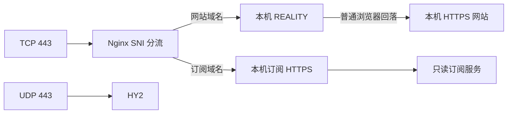

# Forlooong sing-box 管理栈

本分支将原 233boy 脚本改为 Nginx、sing-box 和私有订阅的统一管理器。已完成一台 Debian 12 amd64 [测试服务器验收](docs/server-validation-2026-10-13.md)；本地 Linux 验证结果和其他环境的未验证边界见 [验证记录](docs/validation.md)。原 `src/` 保留用于归属和迁移参考，新入口不会执行旧修改逻辑。

默认创建 VLESS REALITY TCP/Vision 和使用可信证书的 HY2。订阅输出 Mihomo YAML 与 Base64 原始链接，只有一个 `节点选择` 分组，支持本地节点及手工 URI 导入。



REALITY 的目标是本机 HTTPS 网站监听，不指回公网443。TCP与UDP可以使用相同端口号；旧部署保留UDP443时，新HY2会改用空闲端口。网站默认提供时钟、时区和秒表，可用 `sb site set` 替换。

## 安装

支持 Debian12/13、Ubuntu24.04，systemd，amd64/arm64。需要两个独立域名，全部 A/AAAA 记录指向服务器，关闭 CDN 代理。准备公网TCP80/443和所需UDP端口；脚本不修改防火墙或SSH。

先检查完整源码或明确版本发行包；发行包用随包的 `SHA256SUMS` 校验。不要将此安装器作为不完整的 `curl | bash` 脚本执行。

`--email` 是 Let's Encrypt 证书账户的普通联系邮箱，不是邮箱密码或 Cloudflare API 令牌。当前方案通过公网 TCP80 验证域名控制权。

```sh
apt-get update
apt-get install -y python3 python3-yaml
sh install.sh --site site.example.com --subscription-domain sub.example.com --email admin@example.com
sb check
sb sub url
```

默认从 `Forlooong/clash-rules-mrs` 拉取四来源已构建规则快照。首次下载、哈希、MRS解码或完整客户端配置验证失败则不发布订阅。明确不需要这些规则时，可在安装命令增加 `--without-rules`，以后用 `sb rules update` 启用。

## 迁移与日常管理

```sh
python3 -m sbmanager.cli migrate inspect
sh install.sh migrate --site new-site.example.com --subscription-domain sub.example.com --email admin@example.com --public-server ORIGINAL_IP_OR_DOMAIN
sb help
sb help sub
sb sub name "最伟大的派送员"
sb sub url
sb status
sb node list
sb rules update
```

`sb`、`sb help`、`sb --help` 显示相同的中文操作指南；`sb help node` 等命令按主题列出用法，具体参数用 `sb node add -h` 查看。`sub` 是 `subscription` 的简写，原有命令继续可用。

`sb sub name "自定义名称"` 设置客户端导入时的订阅名称；不带名称时查看当前值。改名不更换链接或节点名称。已导入的客户端可能保留本地名称，可在客户端改名或重新导入。修改路径前缀用 `sb sub path private/path`；需要立即撤销全部旧链接时才使用 `sb sub rotate`，之后通过 `sb sub url` 获取新地址。

自动迁移仅接受可识别的233boy sing-box/Caddy和本项目原独立订阅服务。旧端口、凭证、REALITY SNI、核心版本和证书pin保留；未知路由、自建Nginx/Xray或来源IP依赖整体拒绝。兼容服务保留到显式 `sb node retire`。迁移需要短暂重连。

- [完整命令、证书与回滚](docs/operations.md)
- [迁移范围与阻断条件](docs/migration.md)
- [协议能力与限制](docs/protocols.md)
- [订阅、模板、手工流量信息与规则](docs/subscription.md)
- [验证记录](docs/validation.md)
- [已批准的实施顺序](docs/implementation-plan.md)

修改域名和路径会保留历史别名；轮换令牌则立即作废所有旧URL。文件、配置、服务切换采用持久事务，失败回滚；撤销令牌不会因回滚复活。各项变更须通过Nginx、sing-box、Mihomo校验和就绪检查。首次安装失败可能留下基础系统依赖及无登录权限的服务用户。

## 固定依赖与验证

[versions.json](versions.json) 固定候选版本与下载SHA256：sing-box1.14.3、Mihomo1.19.32、Nginx1.30.5；客户端适配目标为Clash Verge Rev2.5.8。已有旧核心不随迁移升级。Nginx使用官方签名软件源，已有Nginx不被隐式升级。

```sh
python3 -B -m unittest discover -s tests -v
python3 tests/integration_core.py --traffic --remote-rules
```

集成测试仅使用隔离目录、高位loopback端口和临时凭证；不安装系统包、不修改systemd、防火墙或系统CA。CI执行单元与真实核心流量测试；手工打包工作流只产出归档与SHA256，不自动发布或部署。

Debian 12 amd64 的真实公网ACME签发、续期演练、systemd安装及外部REALITY/HY2连接已在上述测试服务器通过。其他系统、ARM64、真实旧部署迁移及不同客户端网络仍须分别验收。DNS解析和本机TLS检查不能证明中国境内直连质量，也不能保证匿名性。

基于 [233boy/sing-box](https://github.com/233boy/sing-box) 与 [Forlooong/sing-box](https://github.com/Forlooong/sing-box)，按仓库 [GPL许可证](LICENSE) 保留归属。
